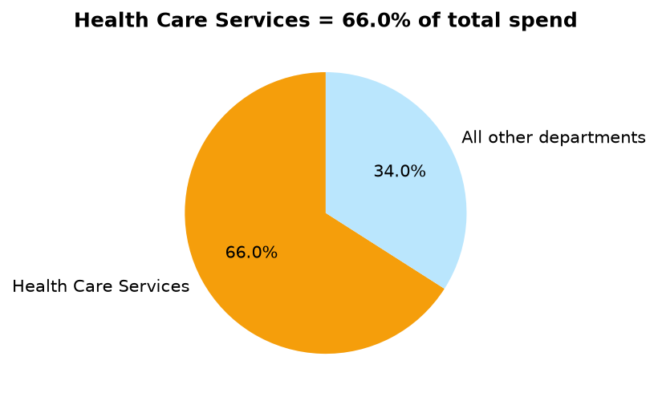
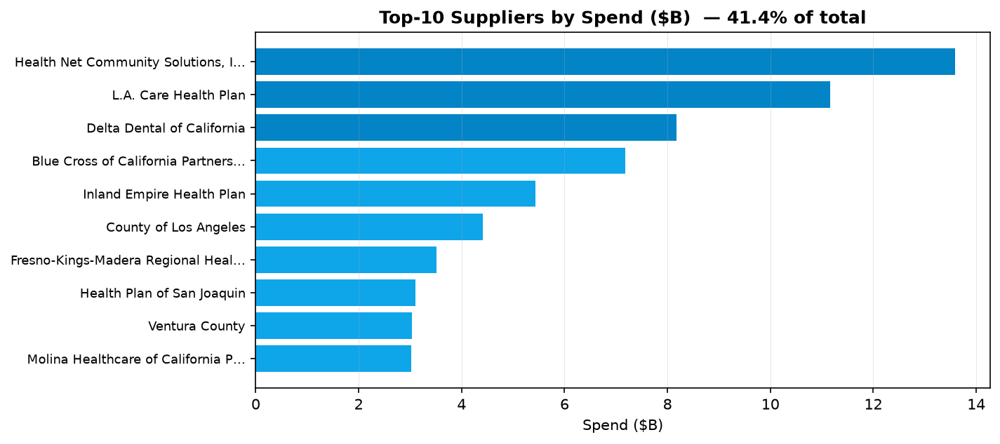
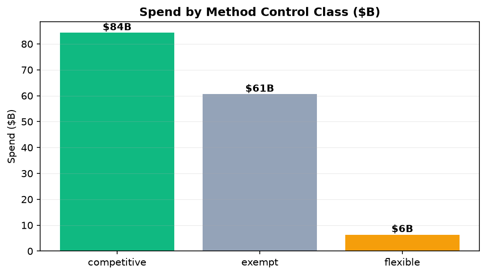

# 采购订单对账与分析（Procurement & Purchase-Order Reconciliation）

> 项目目标：把加州政府一整套真实的采购订单数据清洗、对齐成一张可用的大表，找出**钱都花在哪、是否过度集中、哪些采购在管控之外**，最后给出采购/财务团队能落地的治理与对账建议。
> 数据：加州政府采购订单提取（约 34.6 万条有效记录，2012–2015，支出合计约 **$151.2B**）。

## 一、业务背景与目的

州政府每年通过成千上万张采购订单（PO）花掉巨额资金，但常常看不清：钱集中在哪些机构、哪些支付走的是"合法豁免"或"灵活方法"（管控较弱）、哪些付款方需要重点对账。本项目通过把脏乱的 PO 导出数据清洗成统一口径，量化这些问题，让采购/财务团队把**对账、治理、战略供应商管理**用在刀刃上。

**"对账"在这里是数据层含义**：把一份 90.9 万物理行（部分文本跨多行）的导出折叠成一张去重、可匹配的 PO 表。业务层的"支付对账（claims vs invoice vs PO）"需要本项目数据中没有的索赔/发票数据——报告如实量化了这一缺口并列为下一步，而不是假装已完成。

## 二、数据清洗与预处理

- 金额 `$` 符号、日期、供应商名归一化；派生邮政编码、UNSPSC 品类段、采购方式管控分类等特征。
- **数据质量问题被如实记录**：`Purchase Date` 原始值含 1911–2912 年的离谱年份，17,634 条异常置空（0 行丢失）；时间趋势以干净的 `creation_date`（2012–2015）为准。
- 单价离群筛查做过**评估后放弃**：2 位品类段粒度过粗、约 26% 标记率不可靠——保留为可复现证据，说明做单价结论前必须先建 SKU/市场价基准，绝不硬凑。

## 三、关键指标

| 指标 | 数值 |
|---|---|
| 总支出 | **$151.2B**（200,533 张 PO、24,732 家供应商） |
| 集中度 | CR4 = 26.5%，CR8 = 37.4%，top-10 = 41.4%（全是医疗付款机构） |
| 行业 | Health Care Services 占 66% 支出；UNSPSC 医疗段(85) 占 **73.9%** |
| 支出结构 | 一次性/大额结算 = 68.8%（4,583 家收款方）；**30.1% 经常性核心**（1,921 家多年合作方）= 战略层 |
| 采购方式管控 | **40.1% 支出属法定豁免**（集中在经常性核心 59.7%，多为政府间转移）；$6.36B 为"灵活方法"（需流程复核清单） |

支出很"块状"：一次性/大额结算与经常性核心在支出排名里是看不出的两种结构——KMeans 供应商分层把它们分开。

## 四、建模

- **供应商分层（KMeans，无监督）**：按支出/持续性把供应商分成战略核心 vs 一次性/大额两类，用于差异化治理（经常性核心中约 42% 是私营战略供应商、需作为战略客户管理；其余为政府/公共机构，走政府间转移治理）。
- **采购方式管控分类**（业务规则）：competitive 竞争性 / exempt 豁免 / flexible 灵活方法三类，输出 $6.36B 灵活方法复核清单。

**为什么不用深度学习**：本任务是支出结构诊断 + 供应商分层，核心诉求是"可解释、能落到治理动作"，KMeans + 规则已足够；且没有序列/图像类数据，DL 在这里增益极小、反而伤害可解释性。

## 五、报告预览与关键图表





> 完整交互版报告：`index.html`（业务目标 → 清洗 → 指标 → 建模 → 建议，每个图表都带 Insight + Action）。GitHub 不渲染仓库内 HTML，请 clone 后本地打开。

## 六、数据来源

原始数据在项目内 `data/raw/`（不入 git——clone 后请自行下载）。

| 文件 | 说明 | Kaggle 下载 |
|---|---|---|
| `PURCHASE ORDER DATA EXTRACT 2012-2015_0.csv` | 加州政府采购订单提取，约 34.6 万条记录，2012–2015 | `kaggle datasets download -d sohier/large-purchases-by-the-state-of-ca -p data/raw --unzip` |

- Kaggle 页面：https://www.kaggle.com/datasets/sohier/large-purchases-by-the-state-of-ca
- 官方源：加州开放数据门户（data.ca.gov）全州采购/采购订单导出。
- 诚实说明：本仓库用的是官方 CA PO 导出；Kaggle 镜像（sohier/large-purchases）属于同一 CA 采购域，具体列覆盖可能有差异。

```bash
pip install kaggle
kaggle datasets download -d sohier/large-purchases-by-the-state-of-ca -p data/raw --unzip
# 需要 kaggle.json / KAGGLE_USERNAME + KAGGLE_KEY 认证
```

## 七、运行方式

```bash
pip install -r requirements.txt
python scripts/clean_data.py        # 原始 CSV -> output/procurement_clean.parquet
python scripts/analyze.py           # 总览指标（CR4/CR8、top-10、HHI）
python scripts/analyze_extended.py  # 部门 / 品类 / 月度趋势
python scripts/supplier_cluster.py  # KMeans 供应商分层
python scripts/ml_analysis.py       # 灵活/豁免复核清单
python scripts/generate_charts.py   # 图表 -> assets/*.png
python -m pytest tests -q           # 单元 + 报告 + 输出契约测试
```

## 八、建议（摘要）

1. 对一次性/大额层做**支付对账**（索赔 vs 发票 vs PO，费率与结算审计）——标注为下一步、需索赔/发票数据。
2. 记录核心层豁免支出，并对 $6.36B 灵活方法做抽样复核。
3. 把约 42% 私营经常性核心供应商当**战略客户**管理；公共机构走政府间转移治理。
4. 任何单价结论前先建 SKU/市场价**基准**。

— Jiawei Wang
